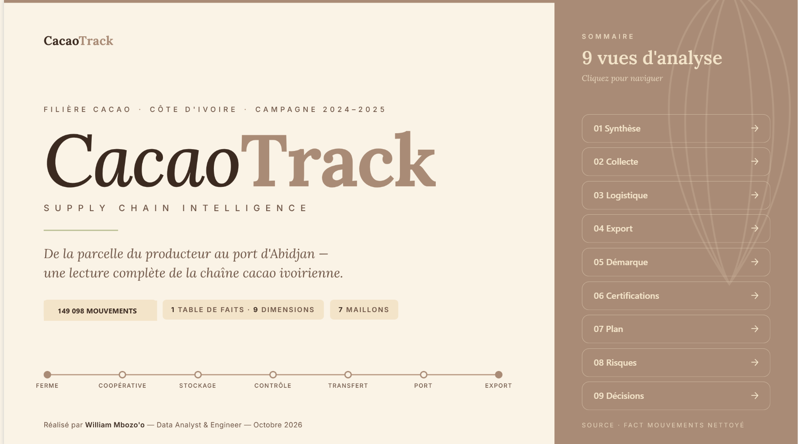
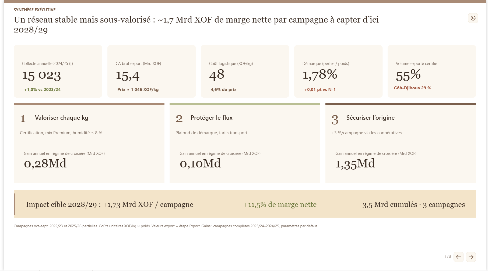
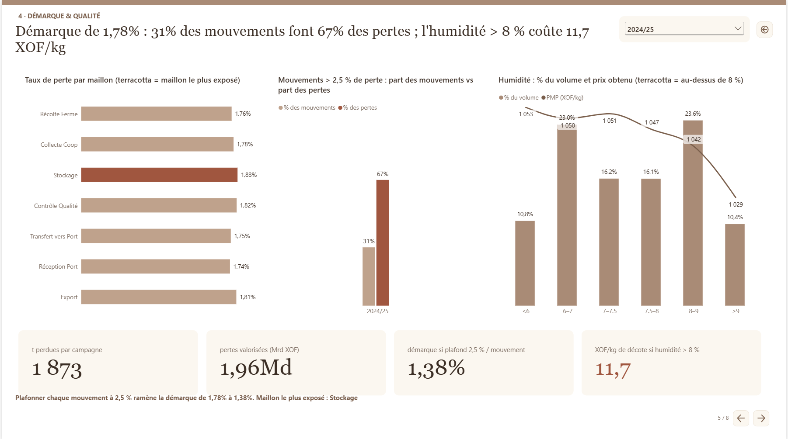

# 🍫 CacaoTrack — Performance Supply Chain du Cacao en Côte d'Ivoire

> De la parcelle au port : un rapport Power BI exécutif de 10 pages qui identifie **+1,73 Md XOF de marge nette par campagne** à capter d'ici 2028/29.


---

## 👤 À propos

**Auteur : William Mbozo'o** — Ingénieur en systèmes d'information (Data / BI, Product Owner), Yaoundé.

📲 [WhatsApp](https://wa.me/237691932723) · 🌐 [Portfolio](https://www.william-mbozoo.me/data-engineer) · 💼 [LinkedIn](https://www.linkedin.com/in/william-mbozoo) · 🐙 [GitHub](https://github.com/mbozoomengo)

---

## 📑 Sommaire

1. [Aperçu](#-aperçu)
2. [Problème métier](#-problème-métier)
3. [Insights et décisions](#-insights-et-décisions)
4. [Architecture des données](#-architecture-des-données)
5. [Préparation des données](#-préparation-des-données)
6. [KPIs clés](#-kpis-clés)
7. [Mesures DAX](#-mesures-dax)
8. [Aperçu visuel](#-aperçu-visuel)
9. [Stack technique](#-stack-technique)
10. [Limites et évolutions](#-limites-et-évolutions)
11. [Contact](#-contact)

---

## 🎯 Aperçu

| | |
|---|---|
| **Démo en ligne** | [Voir le dashboard](https://app.fabric.microsoft.com/reportEmbed?reportId=c44b30a2-c8c9-4066-b8ec-17fdc94c61de&autoAuth=true&ctid=b80db56c-9aad-4d81-97b3-e0b7a5d52b1d) |
| **Périmètre** | 149 098 mouvements · 120 coopératives · 60 transporteurs · 2 ports (Abidjan, San-Pédro) |
| **Période** | Campagnes 2022/23 à 2025/26 (campagne = octobre → septembre) |
| **Rapport** | 10 pages + 1 infobulle, 136 mesures DAX, 5 curseurs what-if |
| **Gain identifié** | **+1,73 Md XOF** par campagne en 2028/29 · **3,5 Md XOF** cumulés sur 3 campagnes |

> Données d'étude : les chiffres servent à démontrer la méthode d'analyse. Aucune donnée confidentielle.

---

## 🧩 Problème métier

Un exportateur de cacao ivoirien pilote une chaîne en 7 maillons : **Ferme → Coopérative → Stockage → Contrôle qualité → Transfert → Réception port → Export**.

| # | Question de la Direction | Réponse apportée |
|---|---|---|
| 1 | La collecte croît-elle vraiment ? | Non : elle plafonne à ~15 000 t. La hausse de +37 % vient de **campagnes partielles**. |
| 2 | Où se perd la marge en logistique ? | Coût de ~48 XOF/kg (4,6 % du prix). Le levier est la **dispersion des tarifs** (0 à 87 XOF/kg). |
| 3 | Comment créer de la valeur à prix figé ? | Par le **mix variété × grade** : Criollo Premium vs Forastero Standard = +247 XOF/kg (+26 %). |
| 4 | Où et pourquoi perd-on du volume ? | Pertes diffuses (~1,77 %), **concentrées sur 1 mouvement sur 3**. |
| 5 | Les certifications paient-elles ? | Levier de **marge** (+50 XOF/kg), pas de fidélisation. |
| 6 | Quel plan, quel ROI, quels risques ? | 3 priorités simulables, scénario prudent à −30 % de volume, matrice de 7 risques. |

---

## 💡 Insights et décisions

| Constat | Chiffre | Décision proposée |
|---|---|---|
| **Valoriser chaque kg** | Certification, mix Premium, humidité ≤ 8 % | **+0,28 Md XOF/an** |
| **Protéger le flux** | Plafond de démarque à 2,5 %, appel d'offres transport | **+0,10 Md XOF/an** |
| **Sécuriser l'origine** | +3 % de volume/campagne via contrats coopératives | **+1,35 Md XOF/an en 2028/29** |
| Concentration des pertes | 31 % des mouvements = 67 % des pertes | Plafonner la démarque à 2,5 % (1,77 % → 1,37 %) |
| Transport hétérogène | 34 % du volume = 46 % du coût au-delà de 40 XOF/kg | Cibler l'appel d'offres sur cette tranche |
| Certification inégale | Gôh-Djiboua : 29 % certifié | Prioriser les investissements dans cette région |
| Robustesse | Scénario −30 % de volume | Gain maintenu à 1,33 Md XOF |

---

## 🏗️ Architecture des données

Un fait central relié à **10 dimensions** (relations 1-N, filtrage unidirectionnel). Chaque ligne trouve une correspondance grâce à un membre **« Inconnu » (clé -1)**.

```
                    dim_Date ──────┐
                   dim_Produit ────┤
                      dim_Lot ─────┤
               dim_Cooperative ────┤
                    dim_Ferme ─────┼──►  fact_Mouvements
                     dim_Site ─────┤     (149 098 lignes)
             dim_Transporteur ─────┤
                    dim_Port ──────┤
               dim_Evenement ──────┤
                   dim_Devise ─────┘
```

| Type | Table | Rôle |
|---|---|---|
| **Fait** | `fact_Mouvements` | 1 ligne = 1 mouvement logistique (poids, humidité, pertes, coûts XOF/kg, valeur, primes) |
| Dimension | `dim_Date` | Hiérarchie **Campagne → Trimestre → Mois** (octobre → septembre) |
| Dimension | `dim_Produit` | Hiérarchie **Variété → Grade → Produit** |
| Dimension | `dim_Cooperative` | Hiérarchie **Région → Département → Ville → Coopérative** |
| Dimension | `dim_Evenement`, `dim_Lot`, `dim_Ferme`, `dim_Transporteur`, `dim_Site`, `dim_Port`, `dim_Devise` | Maillons, certifications, fermes, flotte, sites, ports, devises |
| Support | `Cascade`, `Plan Campagnes`, `Plan Priorités`, `Hypothèses`, `Risques` | Cascade de valeur, plan d'action, registre des risques |
| What-if | 5 paramètres `p ...` | Simulation par curseurs |
| Mesures | `_Mesures` | 136 mesures en 12 dossiers |

**Bonnes pratiques appliquées**
- Staging séparé : `01_Staging` → `02_Dimensions` → `03_Fact` → `99_Parameters`
- Paramètres (`SourcePath`, seuils d'humidité et de perte) : aucun chemin ni seuil codé en dur
- Colonnes techniques masquées, colonnes de tri dédiées
- *Auto date/time* désactivé, culture `fr-FR`

---

## 🧹 Préparation des données

**14 anomalies** de qualité traitées dans Power Query :

| Problème | Traitement |
|---|---|
| 1 800 identifiants dupliqués | Dédoublonnage (151 800 → 149 098 lignes valides) |
| Dates mêlant dates et texte | Reconstruction propre, 0 ligne sans date |
| Devise `XO F` | Normalisation en `XOF` |
| Poids et sacs négatifs, lignes sans étape | Exclusion |
| Clés manquantes ou hors plage | Redirection vers `Inconnu (-1)` |
| Régions en casse incohérente | Mise en forme propre |
| Coûts en XOF/kg | Montants recalculés = coût unitaire × poids |

Contrôles de recette automatisés : lignes du fait, tonnages, CA brut, prix moyen pondéré, humidité, intégrité des 10 relations.

---

## 📊 KPIs clés

| Domaine | KPI | Valeur (2024/25) |
|---|---|---|
| Collecte | Volume collecté | **15 023 t** (+1,0 % vs 2023/24) |
| Collecte | Volume exporté | **14 689 t** |
| Logistique | Coût logistique / kg | **~48 XOF/kg** (4,6 % du prix) |
| Logistique | Part sous-traitance | 32 % du volume |
| Export | CA brut export | **15,41 Md XOF** |
| Export | Prix moyen pondéré | **~1 046 XOF/kg** |
| Qualité | Taux de perte | **1,77 %** |
| Qualité | Humidité moyenne / décote > 8 % | 7,49 % / ~12 XOF/kg |
| Certifications | Part du volume exporté certifié | **54 %** (RA 22, Fairtrade 16, Bio 8, UTZ 8) |
| Certifications | Prime moyenne / kg certifié | +50 XOF/kg (+4,8 %) |
| Plan | Gain par priorité (P1 / P2 / P3) | 283 M / 95 M / 1 353 M XOF |

---

## 🧮 Mesures DAX

Les **136 mesures** sont rangées dans la table `_Mesures`. Sélection commentée : [`dax/mesures_cles.dax`](dax/mesures_cles.dax).

Techniques : variation à périmètre comparable (YTD campagne), pondérations, cascade de valeur, Top/Flop N, what-if, formatage conditionnel, titres dynamiques.

---

## 🖼️ Aperçu visuel

Thème sur mesure « *CacaoTrack Executive* » (palette cacao/moka), titres d'action pilotés par mesures DAX, navigation par boutons, filtre Campagne synchronisé.

### 00 · Vue d'ensemble


### 01 · Synthèse exécutive


### 04 · Démarque & qualité


<details>
<summary>Les 10 pages du rapport</summary>

| Page | Contenu |
|---|---|
| Couverture & sommaire | 9 boutons de navigation |
| 01 · Synthèse exécutive | Vue d'ensemble |
| 02 · Diagnostic de la collecte | Top 5 / Flop 5 |
| 03 · Performance routière | Logistique et sous-traitance |
| 04 · Flux d'exportation | Valorisation prix |
| 05 · Démarque & qualité | Pertes et humidité |
| 06 · Certifications | Cascade d'impact économique |
| 07 · Plan d'action & ROI | 5 curseurs what-if |
| 08 · Hypothèses & risques | Matrice probabilité × impact |
| 09 · Décisions attendues | Arbitrages pour le Comité |

</details>
---

## 🛠️ Stack technique

`Power BI Desktop` · `DAX` · `Power Query (M)` · `Modélisation en étoile` · `Excel (source)`

---

## ⚠️ Limites et évolutions

- Comparaison des campagnes partielles (2022/23 et 2025/26) : lecture à périmètre comparable uniquement.
- Fichiers Power BI disponibles **sur demande** (voir Contact).

---

## 📬 Contact

- 📲 WhatsApp : https://wa.me/237691932723
- 🌐 Portfolio : https://www.william-mbozoo.me/data-engineer
- 💼 LinkedIn : https://www.linkedin.com/in/william-mbozoo
- 🐙 GitHub : https://github.com/mbozoomengo
